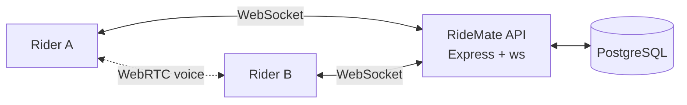

<div align="center">

# RideMate

**Ride together. Stay together. Stay safe.**

A mobile-first group riding app: see every rider live on one map, talk while you ride, and send an SOS with your exact location in one tap.

[Live app](https://ride-mate-frontend-r1lp.vercel.app) · [Backend repo](https://github.com/sanskardev9/RideMate-Backend) · [Features](#features) · [Getting started](#getting-started)


</div>

---

## Features

- **Live group map:** every rider's position updates in real time on a Leaflet map, with an online/offline status and a note of how accurate each position is.
- **Groups:** create or join a riding group, see who's in it, and ride together.
- **Ride sessions:** start a ride and track its duration and distance.
- **Group chat:** real-time messages over WebSockets.
- **Voice calls:** peer-to-peer WebRTC calling with a ringtone and an in-ride call dock.
- **SOS alerts:** one tap alerts the whole group with your live location and an alarm. Cancel just as fast.
- **Built for the handlebars:**
  - A screen wake lock keeps the phone awake mid-ride.
  - A near-silent audio loop keeps Chrome on Android sending your location when you switch apps (see [Limits](#limits)).

---

## Tech stack

| Layer | What |
|---|---|
| UI | React 19, TypeScript, Vite 8, Tailwind CSS 4, React Router 7 |
| Maps | Leaflet with CARTO basemaps (© OpenStreetMap contributors, © CARTO) |
| Realtime | A WebSocket client with reconnects, and WebRTC for voice (STUN/TURN configurable) |
| Backend | [RideMate-Backend](https://github.com/sanskardev9/RideMate-Backend): Node.js, Express, `ws`, PostgreSQL (Supabase), JWT |
| Hosting | Vercel (an SPA rewrite to `index.html`) |

---

## How it works



- **REST** handles sign-in and data: `POST /auth/register` and `POST /auth/login` return `{ access_token, user }`, and the client sends the token as a bearer token on API requests.
- **WebSocket** (`VITE_WS_BASE_URL`) carries the live events:

  | Event | Payload |
  |---|---|
  | `location_update` | `userId`, `name`, `latitude`, `longitude`, `accuracy`, `timestamp`, `online` |
  | `chat_message` | a group message |
  | `sos_trigger` / `sos_cancel` | an alert with the rider's live location, and its cancellation |
  | `call_offer`, `call_answer`, `ice_candidate`, `call_rejected`, `call_ended` | WebRTC signalling, each addressed with `to` |

- **Voice** goes peer to peer over WebRTC. The server only relays the signalling.

---

## Getting started

### Prerequisites
- Node.js 20+
- The [RideMate backend](https://github.com/sanskardev9/RideMate-Backend) running, with its schema (`sql/001_schema.sql`) applied in Supabase

### Run the frontend

```bash
git clone https://github.com/sanskardev9/RideMate-Frontend.git
cd RideMate-Frontend
npm install
```

Create `.env`:

```bash
VITE_API_BASE_URL=http://localhost:8080
VITE_WS_BASE_URL=ws://localhost:8080

# Optional
VITE_CARTO_KEY=
VITE_STUN_SERVERS=
VITE_TURN_SERVERS=
VITE_TURN_USERNAME=
VITE_TURN_CREDENTIAL=
```

```bash
npm run dev      # http://localhost:5173
```

| Script | What it does |
|---|---|
| `npm run dev` | Dev server |
| `npm run build` | Production build into `dist/` |
| `npm run preview` | Preview the build |
| `npm run lint` | oxlint |

### Run the backend

In the backend repo, set `DATABASE_URL`, `JWT_SECRET` and `CLIENT_ORIGIN` in `.env`, then run `npm install` and `npm run dev`.

---

## Project structure

```text
src/
  pages.tsx            Auth, Map, Groups, Group info, Ride, Chat, Profile
  components/          LiveMap, SosButton, CallDock, LocationGate, Layout
  websocket/manager.ts connection, reconnects, event routing
  webrtc/manager.ts    calls: offer/answer, ICE, STUN/TURN
  location/keepAlive.ts wake lock + background keep-alive
  audio/               ringtone, SOS alarm, keep-alive audio
  api/client.ts        REST client with the bearer token
  store/appStore.tsx   app state
```

---

## Deployment

Deploy to Vercel. `vercel.json` already rewrites every route to `index.html`, so links like `/groups/:id` work. Add the `VITE_*` values in the Vercel project settings.

> **Security note:** anything prefixed `VITE_` is bundled into the browser code. Use short-lived TURN credentials (generated per session by the backend), or a TURN service that issues temporary ones, rather than a fixed username and password. Never put server secrets in the frontend.

---

## Limits

- **Location in the background:** the web has no true background location tracking. Chrome on Android keeps the page running while audio plays, but **iOS pauses the page when you switch apps**. Reliable background tracking needs a native shell such as Capacitor.
- **Voice calls on strict networks:** some mobile networks need a TURN server to connect.

---

<div align="center">

Built by **[Sanskar Singh](https://github.com/sanskardev9)**

</div>
